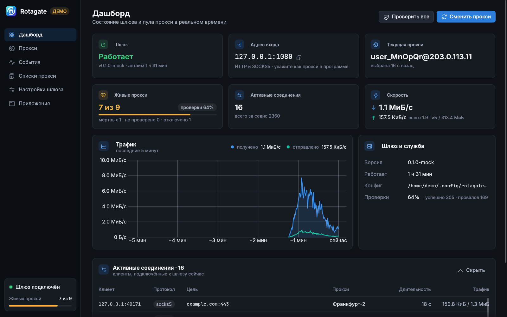
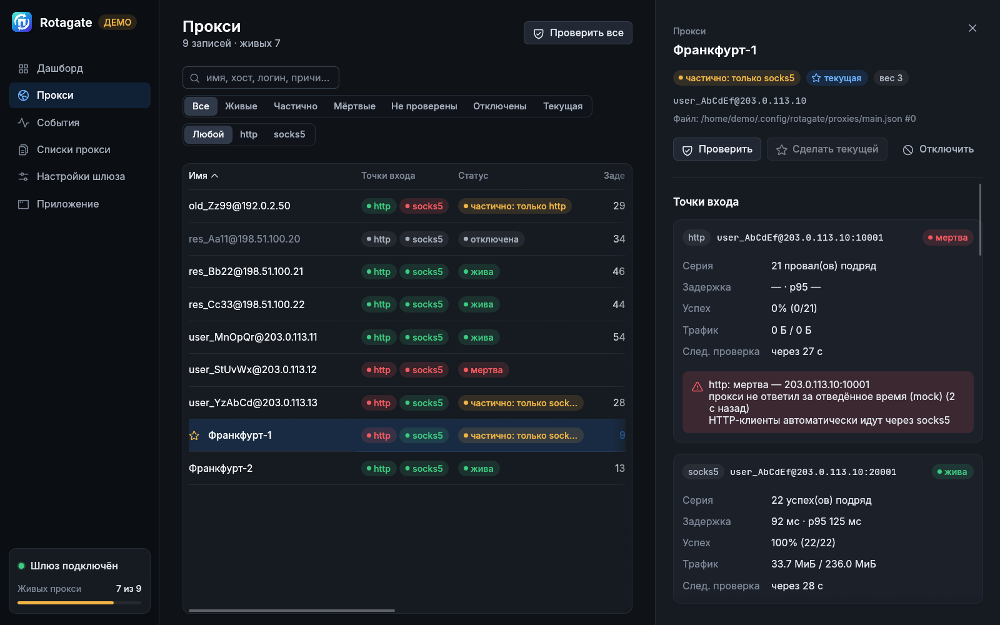
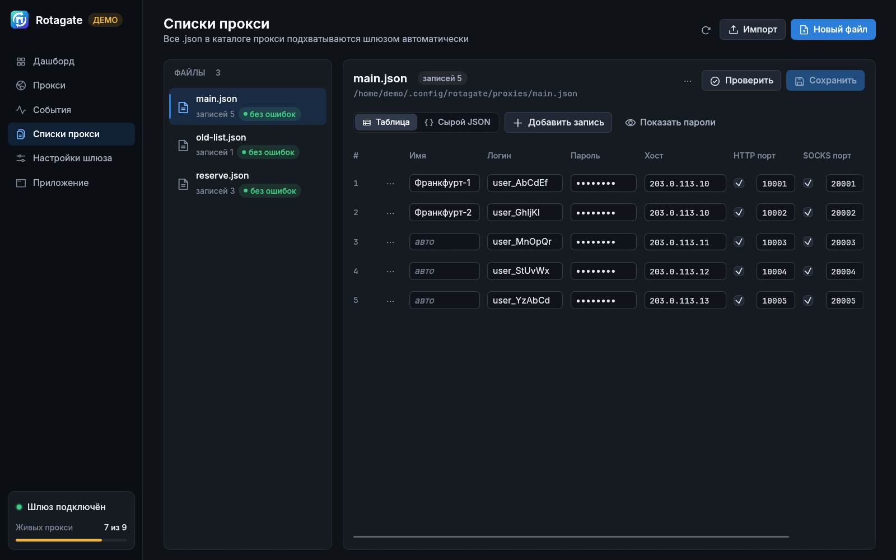
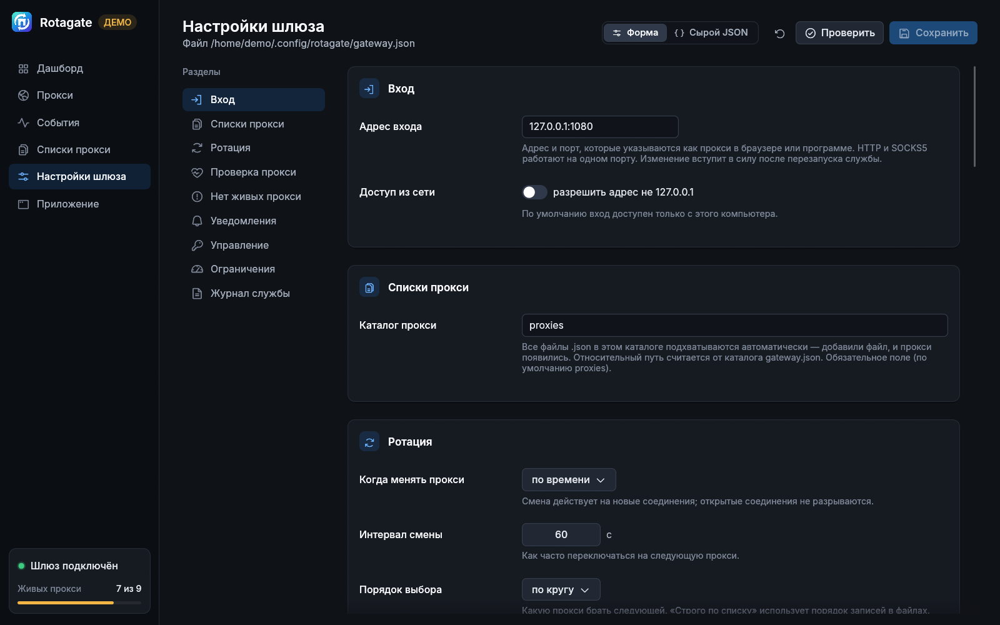

# Rotagate

A local rotating proxy gateway. Rotagate runs one proxy on your machine (HTTP and SOCKS5 on the same port) and spreads your traffic across a pool of upstream proxies from your provider's files. It checks every proxy with real HTTP(S) requests, drops dead ones, brings them back when they recover, and tells you why each failure happened.

* **`rotagated`** is the gateway service (systemd / launchd / Windows). It runs on its own, without the window.
* **`rotagate-ui`** is the desktop app for monitoring and control: dashboard, proxy table, event feed and settings.

> The app's interface is currently in Russian.



| | |
|---|---|
|  |  |
| **Proxies**: status, latency and check history for every proxy | **Proxy lists**: your provider files, editor, drag-and-drop import |
|  | |
| **Settings**: applied on the fly, no restart needed | |

## Features

* HTTP and SOCKS5 on one local port (`127.0.0.1:1080` by default).
* Rotation by time, per connection, every N connections, or only on failure. Proxies are picked round-robin, at random, by weight, by lowest latency, or in strict failover order. Optionally, a domain sticks to one proxy.
* Health checks and automatic failover, including switching between a proxy's HTTP and SOCKS5 entry points.
* **Proxy groups.** Name a set of proxies (or pick them by exit country) and give the group a login and password. A client connects with those credentials and gets only that group's proxies. Clients without credentials use the whole pool.
* Notifications to the log, a webhook or Telegram.
* System tray: switch groups or stop the service.

## Download

Get the archive for your system from **Releases**:

| System | File |
|---|---|
| Linux x86_64 | `rotagate-<version>-x86_64-unknown-linux-gnu.tar.gz` |
| Windows x86_64 (10+) | `rotagate-<version>-x86_64-pc-windows-gnu.zip` |
| macOS (Intel + Apple Silicon) | `rotagate-<version>-universal-apple-darwin.tar.gz` |

`SHA256SUMS` contains checksums for every file.

## Install

**Linux.** Unpack the archive and start the app:

```sh
tar xzf rotagate-*-x86_64-unknown-linux-gnu.tar.gz
cd rotagate-*-x86_64-unknown-linux-gnu
./rotagate-ui
```

**Windows.** Unzip the archive and run `rotagate-ui.exe`. The build is not signed. If SmartScreen shows a warning, click *More info → Run anyway*.

**macOS.** Unpack the archive and drag `Rotagate.app` to *Applications*. The gateway service is already inside the app. The build is not signed, so remove the quarantine flag once:

```sh
xattr -dr com.apple.quarantine /Applications/Rotagate.app
```

On first launch, the app offers to install the gateway service. Choose the per-user option, which needs no admin password. The service then starts automatically when you log in.

If you prefer the command line, run `./rotagated install-service` instead.

## Add your proxies

Put your provider's `*.json` files into the `proxies/` folder. You can also use *Proxy lists → Add file* in the app. Changes are picked up within a few seconds.

| System | Config folder |
|---|---|
| Linux | `~/.config/rotagate/` |
| macOS | `~/Library/Application Support/rotagate/` |
| Windows | `%APPDATA%\rotagate\config\` |

File format:

```json
[{
  "login": "user", "passwd": "secret", "host": "203.0.113.10",
  "protocol": {
    "http":  {"port": 10001},
    "socks": {"port": 20001}
  }
}]
```

## Use it

```sh
curl -x http://127.0.0.1:1080 https://httpbin.org/ip
curl --socks5-hostname 127.0.0.1:1080 https://httpbin.org/ip
```

To use a group, connect with the group's login and password. Browsers and some apps can't send credentials to a SOCKS proxy without asking, so groups also have their own port: the main port + 1, so `1081` by default. That port always requires a login. The **Строка подключения** (connection string) button on a group, under *Настройки шлюза → Прокси-группы*, shows a ready-to-paste connection string.

The full user guide (`GUIDE.md`, in Russian) is included in every archive.

## License

Proprietary. © 2026 Naguwal. All rights reserved. See `LICENSE` and `THIRD-PARTY-LICENSES.md` in the archive.

IP geolocation by [DB-IP](https://db-ip.com) (CC BY 4.0).
